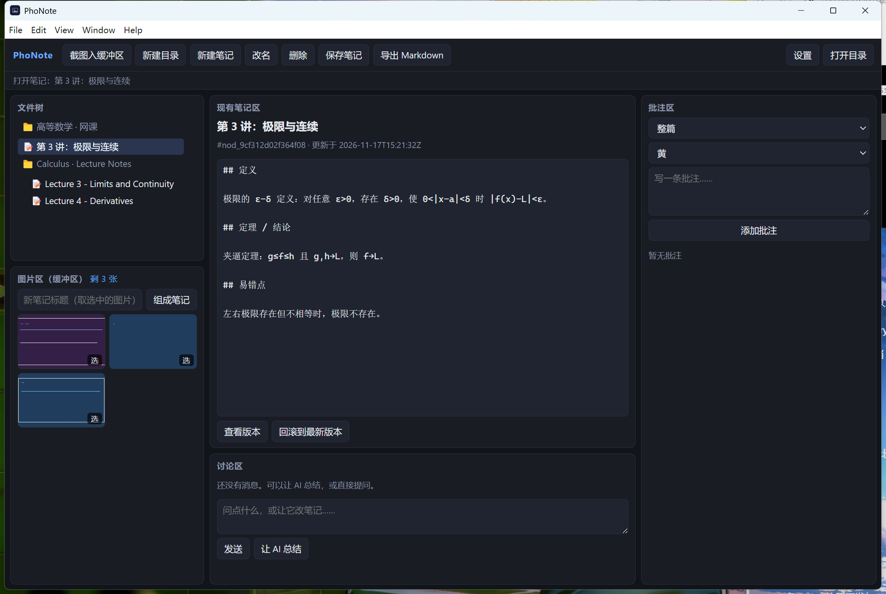

# PhoNote

> 边听网课边截图，顺手把截图变成可编辑、可批注、可让 AI 改的笔记。

PhoNote 是一个 Windows 桌面应用：按一个全局热键把当前屏幕**静默截图**进图片缓冲区，
从中挑任意多张**组成一篇笔记**，然后在同一个窗口里读、改、批注、导出，
并可以让 AI 总结要点或直接给「把这段换成那段」的补丁——**补丁逐条确认后才落盘**。

它**自带后端**：安装包里已经打进了 Python 运行时与业务代码（`phonote-backend.exe`），
装完就能用，不需要装 Python，也不需要另外起服务。



三个分区一目了然：左边文件树 + 图片缓冲区，中间现有笔记区 + 讨论区，右边批注区。

## 它解决什么问题

听课时真正费时的不是记，而是三件事：截图散落在相册里、笔记和截图对不上号、
AI 生成的"总结"把你原来的结构冲掉。PhoNote 的做法是：

- **截图即入缓冲区**：全局热键（默认 `Control+Alt+P`，可自己录制）截当前屏幕，
  不弹窗、不打断播放，图片直接进图片区。
- **笔记 = 缓冲区里任意多张图的组合**：一套课可以攒一堆图，最后挑相关的几张组成一篇笔记；
  用过即从缓冲区消失，不重复、不歧义。
- **Markdown 是唯一真话**：笔记正文就是 Markdown，图按 sha256 内容寻址落盘；
  导出 Markdown 时图片是绝对路径，粘到哪儿都能看。
- **AI 只提补丁，不直接改**：模型返回「摘要 + 若干条 `find → replace`」，
  界面先列出来给你看，点「套用补丁」才写回正文，并且**旧版本自动进历史**，可回滚。
- **批注分三种锚点**：整篇、选中文字、图片区域（后两者目前是占位锚点，见"已知限制"）。

## 功能一览

| 能力 | 说明 |
|---|---|
| 全局热键截图 | 默认 `Control+Alt+P`；设置里点「录制」可改任意组合，被别的程序占用会明确提示 |
| 图片缓冲区 | 缩略图墙，多选后组成笔记；只显示还没被用过的图 |
| 文件树 | 任意深度、可改名/移动/删除（目录非空要显式确认）；同级重名自动加后缀 |
| 笔记编辑 | Markdown 正文 + 图片；保存时自动留历史版本，可回滚 |
| 笔记本体模板 | 新建笔记可套「定义 / 定理·结论 / 易错点 / 例题」骨架 |
| AI 讨论 | 讨论区里直接追问；`off / openai / anthropic / manual` 四种模式，manual 不需要任何 key |
| 批注 | 整篇 / 选中文字 / 图片区域三种锚点，可指定颜色 |
| 导出 | 一键把当前笔记的 Markdown 复制到剪贴板 |
| 备份与同步 | 命令行触发：打自包含 zip；WebDAV push / pull（单主设备，manifest 最后写） |
| 手机端 | 同一 Wi-Fi 下用手机浏览器打开内置的手机版页面（PWA），相册/相机导入 → 组成笔记 |
| 只读模式 | 隐藏全部写入口并停用热键，配合只读 API key 使用 |

## 安装（Windows）

1. 到 [Releases](https://github.com/qw2007/PhoNote/releases) 下载最新的
   `PhoNote-Setup-<版本>-x64.exe`；
2. 双击安装（per-user 装到 `%LOCALAPPDATA%\Programs\PhoNote`，可改目录），
   会建桌面与开始菜单快捷方式；
3. 打开 PhoNote，默认笔记目录是 `%USERPROFILE%\PhoNote`，可在设置里改。

安装包**没有代码签名**，首次运行 Windows SmartScreen 会提示「未知发布者」→
「更多信息」→「仍要运行」。卸载走「应用和功能」里的 PhoNote，或
`"%LOCALAPPDATA%\Programs\PhoNote\Uninstall PhoNote.exe"`。

## 上手三步

1. 开着网课，按热键（或点工具栏「截图入缓冲区」），图片区出现缩略图；
2. 点选要用的图 → 填标题 → 「组成笔记」→ 新笔记出现在左侧树里；
3. 点树里的笔记：中间读正文、右边写批注、下面和 AI 讨论；
   改完「保存笔记」，「导出 Markdown」把结果复制走。

设置项（`%APPDATA%\phonote\settings.json`，一般不用手改）：

| 键 | 作用 |
|---|---|
| `notesDir` | 笔记数据目录（SQLite 库 + 内容寻址的图片） |
| `hotkey` | 截图热键，默认 `Control+Alt+P` |
| `useTemplate` | 新建笔记是否套用内置骨架，默认开 |
| `readonly` | 只读模式：隐藏写入口、不注册热键 |
| `lanAccess` | 允许同一 Wi-Fi 的手机访问手机版页面 |
| `bundleBackend` | 用安装包自带的后端（默认开）；关掉则连 `apiBase` 指定的外部服务 |
| `aiMode` / `aiBaseUrl` / `aiApiKey` / `aiModel` | AI 模式与凭据；改完自动重启内置后端 |

## 手机端（同一 Wi-Fi）

安卓拿不到桌面级热键与文件系统，所以手机侧只做「导入图片 → 组成笔记 → 读笔记」：

1. 桌面端 **设置** 里勾「允许手机访问」并保存——后端从 `127.0.0.1` 改绑 `0.0.0.0` 并自动重启；
2. 对话框会显示 `手机上打开：http://<你的局域网 IP>:<端口>/notes/api/m`；
3. 手机与电脑连同一个 Wi-Fi，浏览器打开该地址 → 菜单里「添加到主屏幕」；
4. 页面里「从相册 / 相机导入」→ 点图选中 → 填标题 →「组成笔记」，桌面端文件树里立刻出现。

首次连不上通常是 Windows 防火墙挡住了那个端口，放行即可（这是局域网 HTTP，建议只在可信网络里开）。

## 架构

```
┌──────────────────────────────┐         ┌───────────────────────────────┐
│ Electron 壳（JS）            │  HTTP   │ 内置后端（Python）            │
│ 热键 / 截图 / 四分区界面     │────────▶│ 驱动平台 + pho_note 插件      │
│ IPC 转发 REST 与图片字节     │  IPC    │ SQLite + 内容寻址图片文件     │
└──────────────────────────────┘         └───────────────────────────────┘
```

- 界面只做展示与交互；**所有读写都落在后端**，壳通过 IPC → REST 调用它，
  这样同一套数据手机版页面也能用。
- 后端就是「[驱动平台](https://github.com/qw2007/DRiver-api)」的一个插件
  （`pho_note`）：工具契约、作用域、错误信封都复用平台的约定，因此也能被 Agent 直接调用。
- 数据只有两种形态：SQLite 库（树 / 笔记 / 批注 / 版本 / 消息）+ 按 sha256 内容寻址的图片文件。

数据目录结构：

```
<notesDir>/
  phonote.db          SQLite（WAL）
  media/ab/cd/<sha256>.<ext>   内容寻址的图片
  backups/            备份 zip 与 pull 前的库快照
  exports/            导出的 Markdown
```

## 自己构建

需要 Node ≥ 20 与（仅构建后端时）Python ≥ 3.11。

```powershell
# 1) 依赖（Electron 二进制走镜像；npm 11 会拦 postinstall，补一步 install.js）
$env:ELECTRON_MIRROR = "https://npmmirror.com/mirrors/electron/"
npm install --no-audit --no-fund
node node_modules/electron/install.js

# 2) 开发模式启动（连你手动起的外部服务）
npm start

# 3) 打包成安装程序（需先按 scripts/build-backend.ps1 生成内置后端）
$env:ELECTRON_BUILDER_BINARIES_MIRROR = "https://npmmirror.com/mirrors/electron-builder-binaries/"
npm run installer
```

内置后端由 `scripts/build-backend.ps1` 用 PyInstaller 打进 `backend/bin/phonote-backend.exe`
（需要驱动平台仓库的源码与虚拟环境，脚本参数见文件头）。

## CI

`.github/workflows/ci.yml` 只做能在干净 runner 上确定完成的事：三个 JS 文件语法检查、
`package.json` 可解析、安装包配置（`build` 段、NSIS 选项、`extraResources`）存在且指向正确路径。
PyInstaller 后端与 Electron 二进制体积太大，不在 CI 里下载。

## 已知限制（不是 bug）

- 多屏只截**第一个屏幕**；高 DPI/缩放的坐标换算未逐一验证。
- 截图在主进程转 JPEG（质量 85、长边 1600）后由后端再归一化成 WebP。
- 批注的「选中文字 / 图片区域」两种锚点目前是占位对象，等选区 UI 补真实坐标。
- AI 一次请求一次响应，没有重试、限流、流式；每次最多带 6 张图，超长笔记可能被截断。
- 补丁只做「唯一匹配的片段替换」：不支持移动图片顺序或改结构。
- 图片区只显示**还没被任何笔记用过**的图；删除节点不会级联删图（图片留在缓冲区）。
- 同步只实现 WebDAV 的 `MKCOL/PUT/GET/DELETE`，没有 `PROPFIND/MOVE`、断点续传；
  **单主设备**约定，本地有未推送改动时 pull 直接拒绝。真实的坚果云/Nextcloud 没连过，
  只用自写的 WebDAV 假服务（真实 HTTP）验过 push → 换目录 pull。
- `openai` / `anthropic` 两种模式只用 `httpx.MockTransport` 测过，**没有对真实模型服务跑过**；
  只有 `manual` 模式验证到端到端（上下文进剪贴板，回复贴回来）。
- 安装包未签名，没有自动更新，只有 Windows 包。
- 手机端只有导入/组笔记/读笔记，没有树增删改、批注与讨论区。

## 文档

- 设计与数据模型：[docs/design/PhoNote.md](docs/design/PhoNote.md)
- 后端插件（驱动平台侧）：[DRiver-api](https://github.com/qw2007/DRiver-api) 的
  `src/driver_platform/plugins/pho_note/`

## License

MIT，见 [LICENSE](LICENSE)。
